<div align="center">




<a href="https://www.linkedin.com/in/prathamesh-khairnar-1aa487269"></a>
<a href="https://prathameshkhairnarportfolio.vercel.app/"></a>
<a href="mailto:yoursprathamesh8374@gmail.com"></a>


</div>


<table border="0" width="100%">
<tr>
<td width="58%" valign="middle">

## 🧑‍💻 About Me

```yaml
name:      Prathamesh Khairnar
role:      Cloud Computing Intern @ SevenMentor
focus:     AWS · Linux · Networking
also:      building AI products end to end
education: B.Tech CSE · Sandip University, Nashik
location:  Nashik, India 📍
status:    open to fresher Cloud / DevOps roles ✅
```

</td>
<td width="42%" align="center" valign="middle">

</td>
</tr>
</table>


## ☁️ Tech Stack

<div align="center">

<b>Cloud & Infra</b><br><br>


<sub>AWS: EC2 · IAM · S3 · VPC · CloudFront · CloudWatch &nbsp;|&nbsp; Linux (RHEL) &nbsp;|&nbsp; Networking (CCNA training) &nbsp;|&nbsp; Google Cloud Arcade Facilitator</sub>

<br><br>

<b>AI & Development</b><br><br>


<sub>Generative AI · Agentic AI · Voice AI · Computer Vision</sub>

</div>


## 🚀 Featured Projects

<table border="0" width="100%">
<tr>
<td width="50%" valign="top">

### 🤖 [DESKSHWETA](https://github.com/Prathameshkhairnarr/DESKSHWETA)
Hindi/English desktop voice assistant with a 3D VRM avatar and multi-provider AI failover (Groq → Gemini → GitHub Models).

`Python` `Gemini` `Edge-TTS` `Playwright`

</td>
<td width="50%" valign="top">

### 🛡️ [ElderCare AI](https://github.com/Prathameshkhairnarr/ElderCareAI)
Voice-first safety platform for seniors with a FastAPI backend and SMS scam detection (XGBoost + TF-IDF, 0–100 risk score).

`Flutter` `FastAPI` `Firebase` `PostgreSQL`

</td>
</tr>
<tr>
<td width="50%" valign="top">

### 🚨 Rakshika
Hindi/Hinglish emergency voice agent reachable over phone (LiveKit SIP) with weather, earthquake and hospital APIs.

`Python` `LiveKit` `Gemini` `Deepgram`

</td>
<td width="50%" valign="top">

### 🧠 [MindBridge](https://github.com/Prathameshkhairnarr/mind-bridge)
Three-tier multi-agent system for detection, support and resource routing. Team Lead at Faraway Hackathon. [Live demo ↗](https://mind-bridge-smoky.vercel.app)

`React` `FastAPI` `LLMs` `AI Agents`

</td>
</tr>
</table>


## 📊 GitHub Activity

<div align="center">


</div>

<div align="center">


</div>
